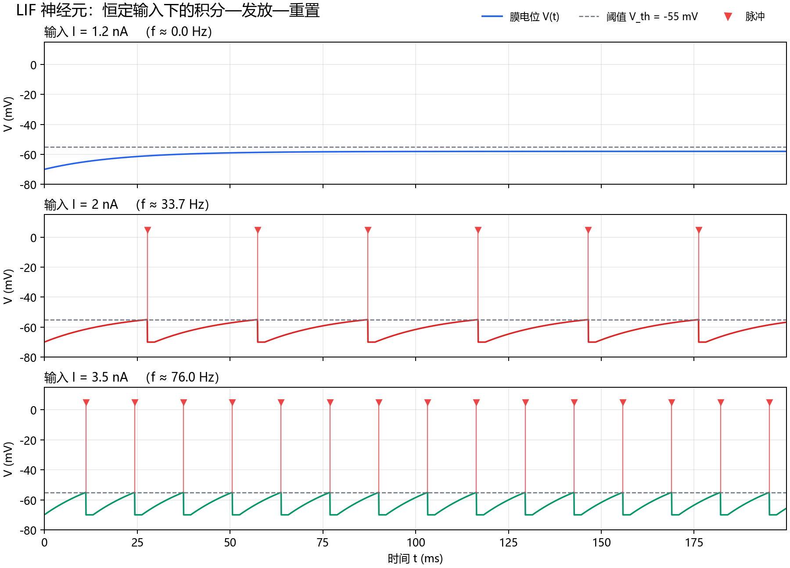
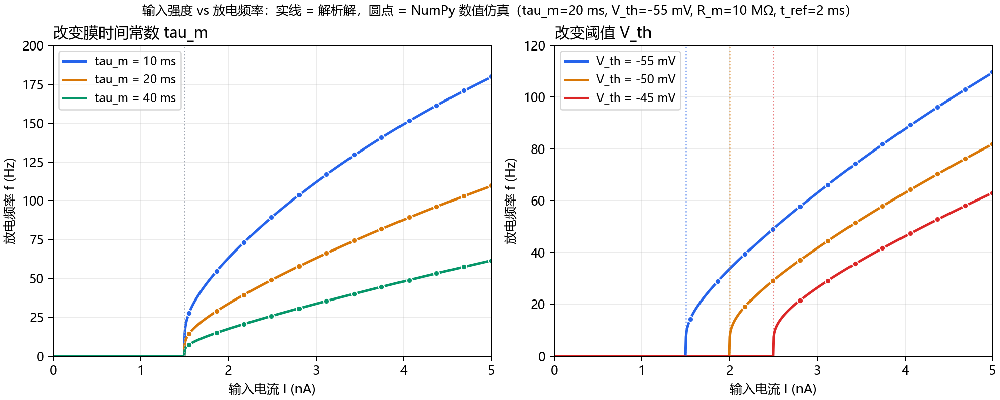
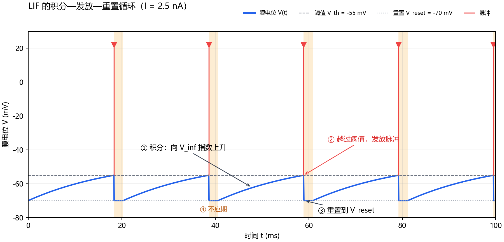

# LIF Neuron in Python + NumPy

> A runnable, tunable, analytically validated Leaky Integrate-and-Fire (LIF) neuron tutorial.

**English** | [简体中文](README.md)


This repository implements a single LIF neuron from scratch with **Python + NumPy**. It focuses on the full learning path:

```text
differential equation -> numerical update -> spike & reset -> firing rate -> f-I curve -> analytic validation
```

The simulation core only needs NumPy. Matplotlib is optional and is used only for figures.



---

## Quick start

```bash
cd lif-neuron-numpy

python -m venv .venv
# Windows PowerShell
.venv\Scripts\Activate.ps1
# macOS / Linux
source .venv/bin/activate

pip install -r requirements.txt
python lif_neuron.py
```

The default command prints a firing-rate table and writes three figures to `figures/`.

Run without Matplotlib:

```bash
python lif_neuron.py demo --no-plots
```

Tune one parameter set:

```bash
python lif_neuron.py run --current 2.0 --tau 10 --v-threshold -50
```

`run` prints the spike count, numerical rate, analytic rate, and the first spike times, and writes `figures/custom_trace.png`.

Use it as a library:

```python
from lif_neuron import LIFParams, simulate_lif, firing_rate_hz

params = LIFParams(tau_m=20.0, v_threshold=-55.0)
result = simulate_lif(params, current_na=2.0, duration_ms=1000.0)

print(result.spikes_ms[:10])
print("f =", firing_rate_hz(result, discard_ms=200.0), "Hz")
```

Install as a local package with the `lif-neuron` entry point:

```bash
pip install -e ".[viz]"
lif-neuron demo
```

---

## Model

```text
tau_m * dV/dt = -(V - E_L) + R_m * I(t)
```

Defaults: `tau_m = 20 ms`, `E_L = -70 mV`, `V_th = -55 mV`, `V_reset = -70 mV`, `R_m = 10 MΩ`, `t_ref = 2 ms`.

When `V >= V_th`, the neuron emits a spike, resets to `V_reset`, and stays clamped there for the absolute refractory period `t_ref`.

With a constant input:

```text
V_inf = E_L + R_m * I
I_rh  = (V_th - E_L) / R_m = 1.5 nA
```

So a constant current at or below 1.5 nA never produces a spike in this model.

### Numerical update

Instead of explicit Euler integration, each step uses the exact exponential solution:

```text
V(t + dt) = V_inf + (V(t) - V_inf) * exp(-dt / tau_m)
```

The only significant numerical error is spike-time quantization by `dt`. Keep `dt <= 0.1 * tau_m`; the default is `0.05 ms`.

### Analytic f-I curve

After a reset, the time to reach threshold is:

```text
T_isi = t_ref + tau_m * ln((V_inf - V_reset) / (V_inf - V_th))
f     = 1000 / T_isi       (Hz)
```

This is implemented in [`theoretical_fi()`](lif_neuron.py#L165) and compared against NumPy simulations in the f-I figure.



### A single spike cycle



---

## CLI

```text
python lif_neuron.py                  # same as `demo`
python lif_neuron.py demo             # table + three tutorial figures
python lif_neuron.py demo --no-plots  # table only
python lif_neuron.py run --current 3 --tau 10 --v-threshold -50
```

Run `python lif_neuron.py --help` or `python lif_neuron.py run --help` for all options.

---

## Tests

```bash
python -m unittest discover -s tests -v
```

The 13 tests cover the rheobase, subthreshold behavior, spike reset, refractory clamping, numerical-vs-analytic firing rates, f-I monotonicity, and `dt` convergence.

CI runs the suite on Python 3.10, 3.11, and 3.12, plus a headless CLI smoke test.

---

## Project layout

```text
.
├── lif_neuron.py
├── tests/test_lif.py
├── figures/
├── .github/workflows/tests.yml
├── pyproject.toml
├── requirements.txt
├── README.md
├── README.en.md
├── LICENSE
└── .gitignore
```

---

## Limitations

This is a teaching example, not a full spiking-neural-network simulator:

- constant current only (no noise, synapses, or arbitrary input waveforms);
- spikes are events, not action-potential waveforms;
- no dendrites, plasticity, adaptation, or network connectivity;
- the analytic f-I formula assumes constant current;
- spike timing is limited by `dt`;
- parameters are illustrative rather than fitted to a specific cell type.

For network-scale work, use Brian2, NEST, or NEURON after working through this example.

---

## References

- Gerstner, W., Kistler, W. M., Naud, R., & Paninski, L. (2014). *Neuronal Dynamics*. Cambridge University Press.
- Dayan, P., & Abbott, L. F. (2001). *Theoretical Neuroscience*. MIT Press.
- Burkitt, A. N. (2006). A review of the integrate-and-fire neuron model: I. Homogeneous synaptic input. *Biological Cybernetics*, 95, 1–19.

---

## Contributing

Issues and pull requests are welcome. Good next steps include noisy input, adaptation currents, and additional parameter sweeps. Please run the test suite before submitting a PR.

---

## License

[MIT](LICENSE).
