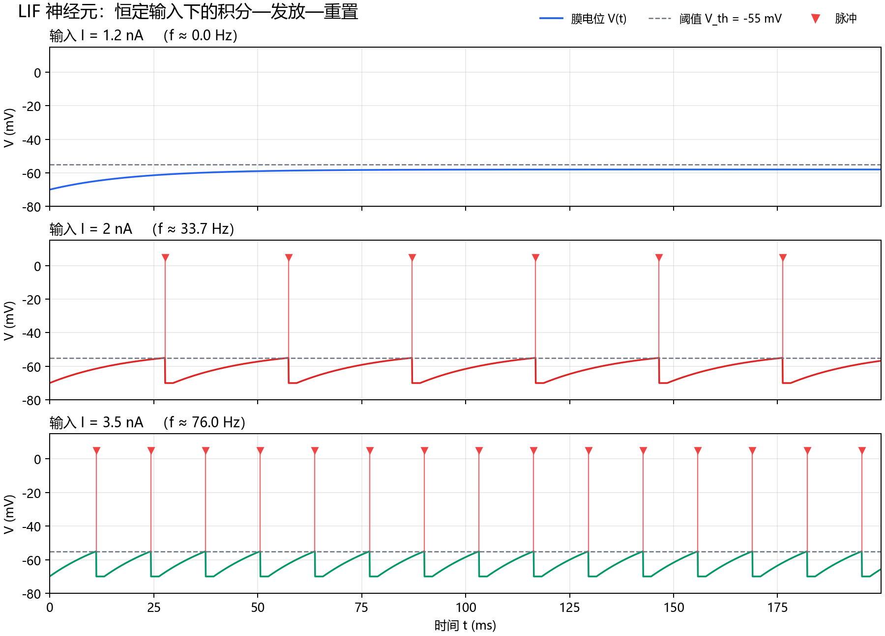
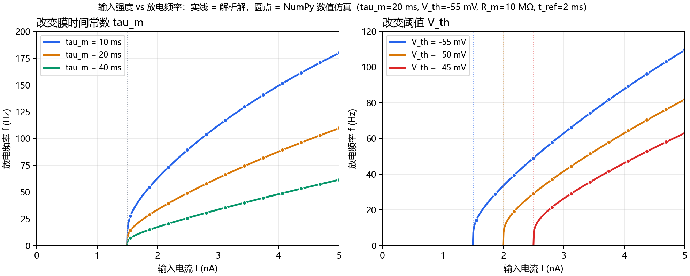
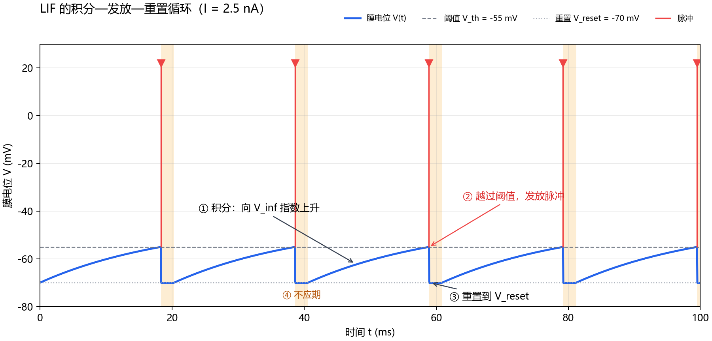

# LIF Neuron in Python + NumPy

> 从膜电位积分到脉冲发放：一个可运行、可调参、带解析解验证的 LIF 神经元教学项目。

[English](README.en.md) | **简体中文**


---

## 这个项目是什么

漏积分放电（Leaky Integrate-and-Fire, LIF）是计算神经科学里最经典的神经元模型之一。这个仓库用**纯 Python + NumPy** 实现单神经元 LIF，重点不是堆功能，而是把下面这条链路讲清楚：

```text
微分方程 → 数值更新 → 脉冲与重置 → 放电频率 → f-I 曲线 → 解析解验证
```

包含：

- 恒定输入下的膜电位时序；
- 阈值、重置和绝对不应期；
- 改变输入强度、`tau_m`、`V_th` 的调参实验；
- 数值 f-I 曲线与解析解的对照；
- 单元测试和 GitHub Actions。

仿真核心只依赖 NumPy；Matplotlib 仅用于绘图，而且可以关闭。



---

## 快速开始

```bash
# 1. 进入项目目录
cd lif-neuron-numpy

# 2. 创建虚拟环境（可选，但推荐）
python -m venv .venv

# Windows PowerShell
.venv\Scripts\Activate.ps1

# macOS / Linux
source .venv/bin/activate

# 3. 安装依赖
pip install -r requirements.txt

# 4. 运行完整演示
python lif_neuron.py
```

默认会打印频率对照表，并在 `figures/` 下生成三张图：

```text
figures/lif_timeseries.png
figures/lif_mechanism.png
figures/lif_fi_curve.png
```

没有安装 Matplotlib 也能跑仿真：

```bash
python lif_neuron.py demo --no-plots
```

### 手动调参

```bash
# 改变输入电流
python lif_neuron.py run --current 3.0

# 改变膜时间常数和阈值
python lif_neuron.py run --current 2.0 --tau 10 --v-threshold -50

# 改变重置电位、不应期和仿真时长
python lif_neuron.py run --current 2.5 --v-reset -65 --t-ref 5 --duration 300
```

`run` 会打印脉冲数、数值频率、解析频率和前几个脉冲时刻，并生成 `figures/custom_trace.png`。

### 作为 Python 库使用

```python
from lif_neuron import LIFParams, simulate_lif, firing_rate_hz

params = LIFParams(tau_m=20.0, v_threshold=-55.0)
result = simulate_lif(params, current_na=2.0, duration_ms=1000.0)

print(result.spikes_ms[:10])
print("f =", firing_rate_hz(result, discard_ms=200.0), "Hz")
```

也可以安装为本地包，获得 `lif-neuron` 命令：

```bash
pip install -e ".[viz]"
lif-neuron demo
```

---

## 模型

LIF 把神经元膜等效成一个会漏电的电容：

```text
tau_m * dV/dt = -(V - E_L) + R_m * I(t)
```

| 符号 | 含义 | 默认值 |
|---|---|---:|
| `V` | 膜电位 | — |
| `tau_m` | 膜时间常数 | 20 ms |
| `E_L` | 漏电反转电位 / 静息电位 | -70 mV |
| `V_th` | 发放阈值 | -55 mV |
| `V_reset` | 脉冲后的重置电位 | -70 mV |
| `R_m` | 膜电阻 | 10 MΩ |
| `t_ref` | 绝对不应期 | 2 ms |
| `I` | 恒定输入电流 | 2 nA |

当 `V >= V_th`：

1. 记录一个脉冲；
2. 将膜电位重置为 `V_reset`；
3. 在 `t_ref` 毫秒内保持在 `V_reset`，不再积分。

恒定输入下，膜电位的稳态是：

```text
V_inf = E_L + R_m * I
```

基强度（rheobase）为：

```text
I_rh = (V_th - E_L) / R_m
     = (-55 - (-70)) / 10
     = 1.5 nA
```

因此 `I <= 1.5 nA` 时没有脉冲；超过之后才开始周期放电。

> 单位约定：`nA × MΩ = mV`。时间用 ms 时，`f = 1000 / 周期(ms)`。

---

## 数值方法：为什么不用朴素欧拉法

在一个时间步 `dt` 内，如果 `I` 不变，方程有解析解：

```text
V(t + dt) = V_inf + (V(t) - V_inf) * exp(-dt / tau_m)
```

代码使用这个指数更新，而不是：

```python
V += dt / tau_m * (-(V - E_L) + R_m * I)   # 显式欧拉
```

前者即使 `dt` 稍大也不会数值爆炸，更不会“冲过阈值”后产生虚假的动态。仿真中唯一的显著误差来源是：脉冲时刻只能精确到采样点，因此建议：

```text
dt <= 0.1 * tau_m
```

默认 `dt = 0.05 ms`，远小于 `tau_m = 20 ms`。

核心循环见 [`simulate_lif()`](lif_neuron.py#L84)：

```python
v_inf = e_leak + r_m * current_na
decay = np.exp(-dt_ms / tau_m)

v_state = e_leak
refractory_until = -np.inf

for k, t_now in enumerate(t):
    if t_now < refractory_until:
        v[k] = v_reset
        continue

    v_next = v_inf + (v_state - v_inf) * decay

    if v_next >= v_threshold:
        v[k] = v_threshold
        spikes.append(t_now)
        v_state = v_reset
        refractory_until = t_now + t_refractory
    else:
        v[k] = v_next
        v_state = v_next
```

几个实现细节：

- 阈值判断使用更新后的 `v_next`；
- 发放后重置的是循环状态 `v_state`，不只是输出数组；
- 不应期内把膜电位钳在 `V_reset`；
- 输出数组在脉冲采样点记录 `V_th`，方便画图；真正的重置从下一个采样点开始。

---

## 解析 f-I 曲线

从 `V_reset` 开始充电到 `V_th`，指数解给出：

```text
T_isi = t_ref + tau_m * ln((V_inf - V_reset) / (V_inf - V_th))
```

因此：

```text
f = 1000 / T_isi       (Hz)
```

代码见 [`theoretical_fi()`](lif_neuron.py#L165)。



从公式可以直接读出调参方向：

| 改动 | 对 f-I 曲线的影响 |
|---|---|
| 增大输入 `I` | `V_inf` 升高，充电更快，频率升高 |
| 增大 `tau_m` | 充电变慢，同样输入下频率降低 |
| 提高 `V_th` | 基强度变大，曲线整体右移 |
| 增大 `t_ref` | 每个周期多一段死时间，频率降低 |
| `I <= I_rh` | 不放电，频率为 0 |

当 `I` 很大时，对数项趋近 0，频率上限趋近 `1000 / t_ref`。默认 `t_ref = 2 ms`，所以这个模型的极限约为 500 Hz。

---

## 三张图看什么

### 1. 膜电位与脉冲时序


- `I = 1.2 nA`：低于基强度，只充电，不放电；
- `I = 2.0 nA`：稳定周期放电，约 33.7 Hz；
- `I = 3.5 nA`：周期更短，约 76.0 Hz；
- 红色三角/竖线是脉冲事件标记，不是真实动作电位形状。

### 2. 单个放电周期



橙色阴影是绝对不应期。脉冲之后膜电位先被钳在 `V_reset`，然后才重新积分。

### 3. f-I 曲线

左图改变 `tau_m`，右图改变 `V_th`。实线是解析解，圆点是 NumPy 仿真；二者误差小于 1%。

---

## 推荐调参实验

固定其余默认参数，只改一个量：

| 实验 | 取值 | 预期结果 |
|---|---|---|
| 输入强度 | 1.2 / 2.0 / 3.5 nA | 0 / 33.7 / 76.0 Hz |
| 膜时间常数 | 10 / 20 / 40 ms，`I = 2 nA` | 63.1 / 33.7 / 17.4 Hz |
| 阈值 | -55 / -50 / -45 mV，`I = 3 nA` | 63.1 / 41.8 / 26.5 Hz |
| 不应期 | 0 / 2 / 5 ms，`I = 3 nA` | 72.1 / 63.1 / 56.0 Hz |

> 接近基强度时频率很低，需要更长的 `duration_ms`，并丢弃开头从静息电位出发的瞬态。

---

## 项目结构

```text
.
├── lif_neuron.py              # 参数、仿真、解析解、绘图、CLI
├── tests/
│   └── test_lif.py            # 13 个单元测试
├── figures/
│   ├── lif_timeseries.png
│   ├── lif_mechanism.png
│   └── lif_fi_curve.png
├── .github/workflows/tests.yml
├── pyproject.toml
├── requirements.txt
├── README.md
├── README.en.md
├── LICENSE
└── .gitignore
```

---

## 测试

```bash
python -m unittest discover -s tests -v
```

测试覆盖：

- 基强度计算；
- 亚阈值不放电；
- 阈值以上产生脉冲；
- 脉冲后重置到 `V_reset`；
- 不应期钳位；
- 数值频率与解析解误差 < 1%；
- f-I 单调性；
- 时间步长收敛性；
- 非法参数报错。

GitHub Actions 会在 Python 3.10、3.11、3.12 上运行测试，并做一次 `demo --no-plots` 的 CLI 冒烟测试。

---

## 模型假设与局限

这是一个**教学用单神经元模型**，不是完整的 SNN 模拟器：

- 只支持恒定输入电流；噪声、突触输入、阶跃输入需要额外实现；
- 不模拟动作电位的真实波形，脉冲只是事件；
- 没有树突、突触可塑性、适应电流或网络连接；
- 解析 f-I 公式只适用于恒定电流；
- 脉冲时刻精度受 `dt` 限制；
- 参数是示意值，不对应某一类真实神经元的定量拟合。

如果要做网络仿真，建议在理解本示例后转向 Brian2、NEST 或 NEURON。

---

## 参考资料

- Gerstner, W., Kistler, W. M., Naud, R., & Paninski, L. (2014). *Neuronal Dynamics: From Single Neurons to Networks and Models of Cognition*. Cambridge University Press.
- Dayan, P., & Abbott, L. F. (2001). *Theoretical Neuroscience: Computational and Mathematical Modeling of Neural Systems*. MIT Press.
- Burkitt, A. N. (2006). A review of the integrate-and-fire neuron model: I. Homogeneous synaptic input. *Biological Cybernetics*, 95, 1–19.

---

## 参与贡献

欢迎提交 Issue 或 PR：修正文档错误、补充实验、增加噪声输入或适应电流都是不错的方向。提交前请先运行测试：

```bash
python -m unittest discover -s tests -v
```

---

## License

[MIT](LICENSE)。可以自由用于学习、教学和二次开发；如果这个项目对你有帮助，欢迎在仓库里点一个 Star。
